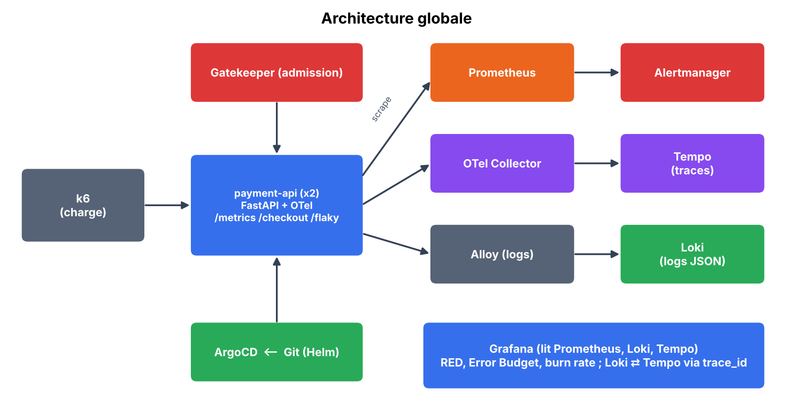
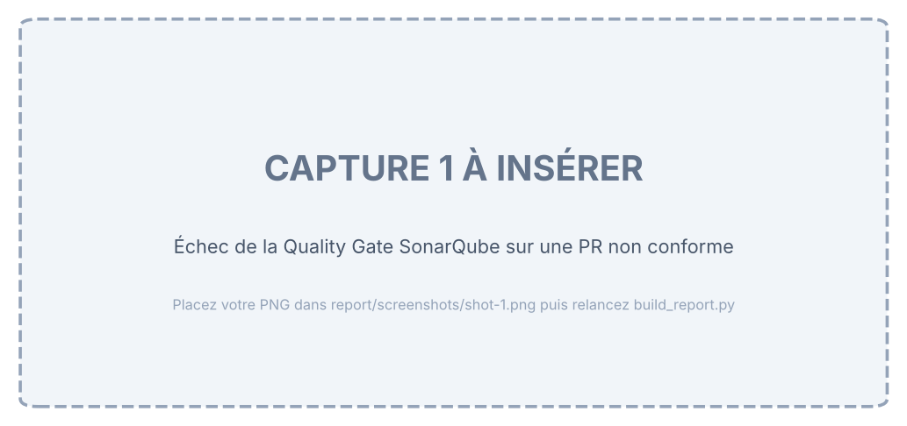
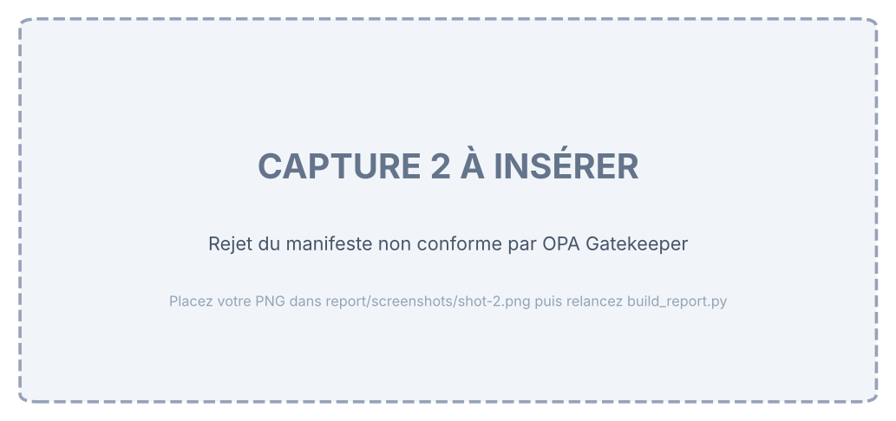
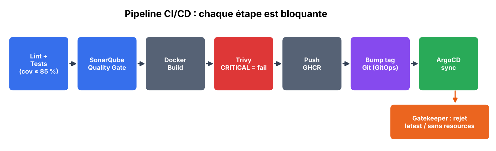
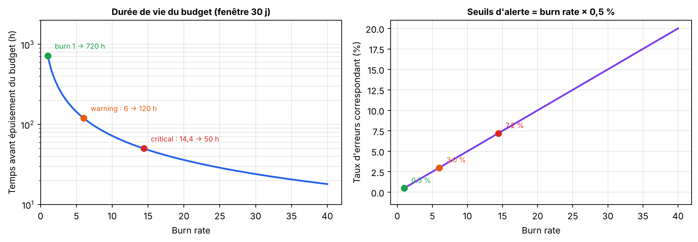
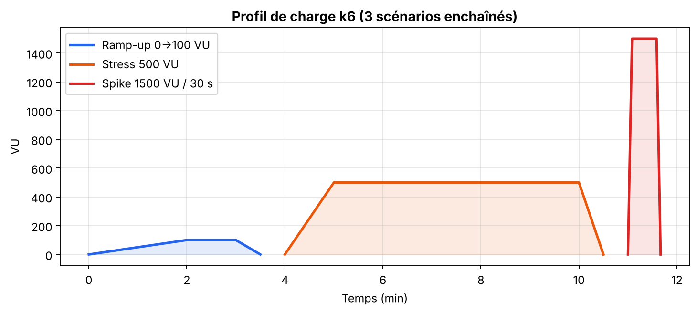
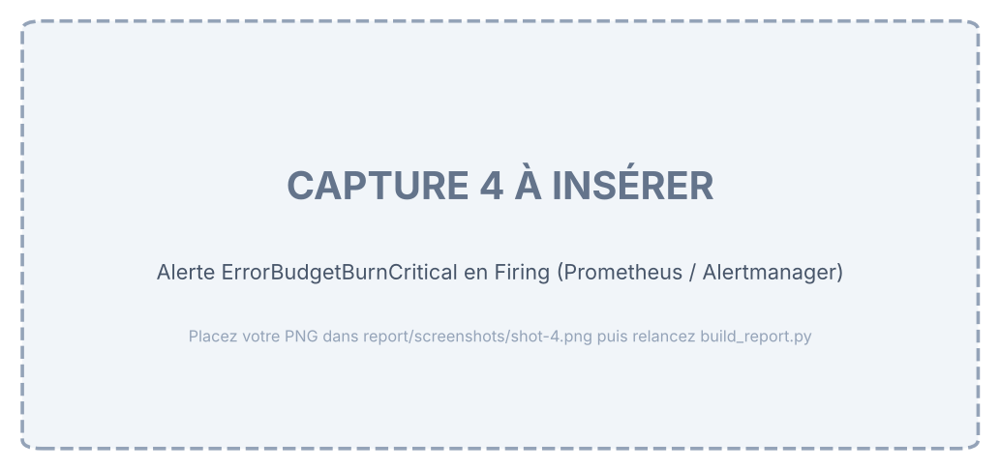

# Rapport SRE — payment-api

*Continuous Delivery, Quality & Security Gates et ingénierie SRE avec observabilité cloud-native*

Auteur : [Nom Prénom]

## 1. Contexte et objectifs

Ce rapport documente la mise en œuvre d'une chaîne de livraison continue sécurisée pour le microservice **payment-api** (FastAPI), avec barrières de qualité (SonarQube), politiques d'admission Kubernetes (OPA Gatekeeper), déploiement GitOps (ArgoCD), observabilité OpenTelemetry (Prometheus, Loki, Tempo, Grafana) et pilotage SRE par SLO et Error Budget.

*Figure 1 — Architecture globale (schéma de conception)*

## 2. Microservice et tests

Le service expose `/products`, `/checkout` (traitement lent simulé, 50–150 ms), `/flaky` (erreurs 503 intermittentes, taux configurable via `FLAKY_ERROR_RATE`), `/health` et `/metrics` (format Prometheus). Les tests couvrent les cas nominaux et aux limites (quantités 0, 1, 100, 101, produit ou devise invalides, succès/échec de `/flaky`, métriques, format des logs JSON).

| Élément | Valeur |
|---|---|
| Seuil de couverture imposé | ≥ 85 % (pytest `--cov-fail-under=85`) |
| Couverture mesurée | [À COMPLÉTER] |
| Rapports générés | `coverage.xml` (Cobertura) et `coverage.lcov` |

## 3. Contrats de qualité et de sécurité

### 3.1 Quality Gate SonarQube

| Condition (nouveau code) | Seuil bloquant |
|---|---|
| Couverture | < 85 % |
| Duplication de lignes | > 3 % |
| Security Hotspots révisés | < 100 % (tout hotspot non révisé bloque) |

L'étape d'analyse du pipeline utilise `sonar.qualitygate.wait=true` : si la Quality Gate échoue, le job échoue et la PR ne peut pas être fusionnée.

*Capture 1 — Quality Gate SonarQube en échec sur une PR non conforme (couverture du nouveau code < 85 %)*

### 3.2 Politiques OPA Gatekeeper

| Contrainte | Template Rego | Effet |
|---|---|---|
| Interdire le tag latest | K8sDisallowLatest | Rejette `:latest` et les images sans tag (latest implicite) |
| requests/limits obligatoires | K8sRequiredResources | Exige resources.requests et limits (cpu, memory) par conteneur |

Les contraintes ciblent Pod, Deployment, StatefulSet et DaemonSet dans le namespace `payment` : le rejet survient dès l'`apply` du Deployment.

*Capture 2 — Rejet par OPA Gatekeeper du Deployment non conforme (tag latest, resources absentes)*

## 4. Pipeline CI/CD et GitOps

*Figure 2 — Étapes bloquantes du pipeline (GitHub Actions) et déploiement ArgoCD*

- Lint (ruff) et tests avec couverture minimale.
- Analyse SonarQube et attente de la Quality Gate.
- Build Docker, scan Trivy (sévérité CRITICAL ⇒ échec), push vers GHCR uniquement sur `main`.
- Mise à jour du tag d'image dans `values.yaml` : ArgoCD synchronise automatiquement (sync auto, prune, selfHeal).
- Secrets : `SONAR_TOKEN`, `SONAR_HOST_URL` (GitHub Secrets) ; webhook Slack (Secret Kubernetes) — aucun secret dans Git.

| Constat | Résultat |
|---|---|
| Pipeline `main` de bout en bout | [À COMPLÉTER] |
| Application ArgoCD | Synced / Healthy : [À COMPLÉTER] |

## 5. Observabilité

- **Métriques** : `http_requests_total` et `http_request_duration_seconds` (buckets incluant 0,2 s), scrapées via les annotations `prometheus.io/*`.
- **Traces** : SDK OpenTelemetry → OTel Collector (OTLP) → Tempo ; span métier `process_payment`.
- **Logs** : JSON structurés avec `trace_id` et `span_id`, collectés par Alloy vers Loki.
- **Corrélation** : *derived field* Loki → Tempo (clic sur `trace_id`) et `tracesToLogsV2` Tempo → Loki.

| Vérification | Résultat |
|---|---|
| Cibles Prometheus UP (job annotated-pods) | [À COMPLÉTER] |
| Navigation log → trace fonctionnelle | [À COMPLÉTER] |

## 6. Ingénierie SRE

### 6.1 SLI / SLO

| Indicateur (SLI) | Objectif (SLO) | Budget d'erreur / 30 jours |
|---|---|---|
| Disponibilité : requêtes avec status < 500 | 99,5 % | 0,5 % ≈ 3 h 36 min |
| Latence : requêtes < 200 ms | 95 % (p95 ≤ 200 ms) | 5 % de requêtes lentes |

### 6.2 Alerting sur le burn rate

Burn rate = taux d'erreurs observé ÷ budget (0,005). Sur 30 jours (720 h) : **2 % du budget en 1 h** ⇒ 0,02 × 720 / 1 = **14,4** ; **5 % du budget en 6 h** ⇒ 0,05 × 720 / 6 = **6**. Chaque alerte combine une fenêtre longue et une fenêtre courte (multi-window) pour limiter les faux positifs et accélérer la résolution.

| Alerte | Condition PromQL | Seuil d'erreurs | Sévérité / canal |
|---|---|---|---|
| ErrorBudgetBurnCritical | erreurs 1 h > 14,4×0,005 et 5 min > 14,4×0,005 (for 2m) | 7,2 % | critical → Page |
| ErrorBudgetBurnWarning | erreurs 6 h > 6×0,005 et 30 min > 6×0,005 (for 15m) | 3 % | warning → Slack |

*Figure 3 — Durée de vie du budget et seuils d'erreurs associés (calcul exact, fenêtre 30 jours)*

### 6.3 Test de charge k6

*Figure 4 — Profil de charge défini dans k6/load-test.js (ramp-up, stress, spike)*

Commande : `k6 run -e FLAKY_SHARE=0.30 k6/load-test.js`. Seuils k6 : `http_req_failed < 0,5 %` et `p(95) < 200 ms`. Hypothèse de travail : avec 30 % du trafic sur `/flaky` (30 % d'erreurs), le taux d'erreurs global est d'environ 9 %, soit un burn rate d'environ 18 (> 14,4) : l'alerte critical doit se déclencher.

| Scénario | RPS | p95 (ms) | % erreurs | Seuils k6 |
|---|---|---|---|---|
| Ramp-up 0→100 VU | [À COMPLÉTER] | [À COMPLÉTER] | [À COMPLÉTER] | [À COMPLÉTER] |
| Stress 500 VU | [À COMPLÉTER] | [À COMPLÉTER] | [À COMPLÉTER] | [À COMPLÉTER] |
| Spike 1500 VU / 30 s | [À COMPLÉTER] | [À COMPLÉTER] | [À COMPLÉTER] | [À COMPLÉTER] |

## 7. Analyse d'incident simulé

Le test de charge simule un incident de fiabilité : la dégradation du taux d'erreurs fait brûler le budget plus vite que prévu.

*Capture 3 — Dashboard Grafana RED + jauge Error Budget pendant le test de charge k6*

*Capture 4 — Alerte ErrorBudgetBurnCritical à l'état Firing dans Prometheus / Alertmanager*

| Chronologie | Heure / observation |
|---|---|
| Début du palier de stress | [À COMPLÉTER] |
| Burn rate 1 h > 14,4 | [À COMPLÉTER] |
| Alerte critical Pending → Firing | [À COMPLÉTER] |
| Notification reçue (Alertmanager / Slack) | [À COMPLÉTER] |
| Error Budget restant après le test | [À COMPLÉTER] % |

### Analyse et actions correctives

- Cause dominante observée (erreurs `/flaky` ou saturation CPU au pic) : [À COMPLÉTER]
- Écart avec l'hypothèse de la section 6.3 et explication : [À COMPLÉTER]
- Actions proposées : circuit breaker / retries sur `/flaky`, HPA sur CPU, ajustement des limites, rate limiting lors des pics, gel des déploiements quand le budget restant passe sous un seuil défini (ex. 25 %).

## 8. Conclusion

[À COMPLÉTER] (synthèse : objectifs atteints, difficultés rencontrées, améliorations possibles).

